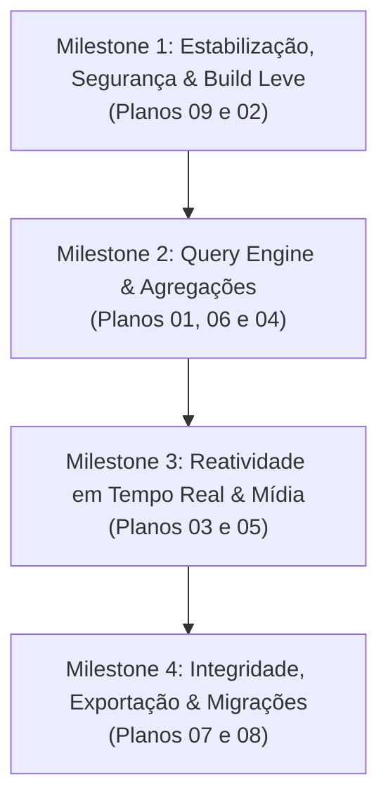

# Roteiro Completo de Implementação do Localbase (Roadmap & Issue Matrix)

Este documento consolida a análise detalhada de **todas as 24 issues abertas** e solicitações históricas da comunidade no projeto [Localbase](https://github.com/samuk190/localbase).

---

## 📊 Matriz de Rastreabilidade: Issues vs. Planos de Implementação

| # Issue | Título da Issue / Solicitação do Usuário | Plano de Implementação Vinculado | Complexidade | Prioridade |
| :---: | :--- | :--- | :---: | :---: |
| **#86** | [Support Comparison Operators in Queries](https://github.com/samuk190/localbase/issues/86) | [Plano 01: Query Engine & `.where()`](docs/plans/01-query-engine-operators-and-where.md) | Média | **Crítica** |
| **#28** | [can i use other operators like "<", ">", "!=" in my queries?](https://github.com/samuk190/localbase/issues/28) | [Plano 01: Query Engine & `.where()`](docs/plans/01-query-engine-operators-and-where.md) | Média | **Crítica** |
| **#15** | [Orderby Two Values](https://github.com/samuk190/localbase/issues/15) | [Plano 01: Query Engine & `.where()`](docs/plans/01-query-engine-operators-and-where.md) | Baixa | **Alta** |
| **#25** | [Retrieve all results where object value matches something](https://github.com/samuk190/localbase/issues/25) | [Plano 01: Query Engine & `.where()`](docs/plans/01-query-engine-operators-and-where.md) | Baixa | **Alta** |
| **#47** | [Update method overwrites variables it's not supposed to overwrite](https://github.com/samuk190/localbase/issues/47) | [Plano 02: Concorrência & Segurança Transacional](docs/plans/02-concurrency-and-transaction-safety.md) | Alta | **Crítica** |
| **#24** | [My delete isn't working / Out of sync state](https://github.com/samuk190/localbase/issues/24) | [Plano 02: Concorrência & Segurança Transacional](docs/plans/02-concurrency-and-transaction-safety.md) | Média | **Alta** |
| **#71** | [Needs querySnapshot (Reactivity)](https://github.com/samuk190/localbase/issues/71) | [Plano 03: Watcher Reativo & `onSnapshot`](docs/plans/03-realtime-watcher-and-query-snapshot.md) | Alta | **Crítica** |
| **#48** | [Watch for changes across renderers/tabs](https://github.com/samuk190/localbase/issues/48) | [Plano 03: Watcher Reativo & `onSnapshot`](docs/plans/03-realtime-watcher-and-query-snapshot.md) | Alta | **Alta** |
| **#62** | [Add support for reactivity](https://github.com/samuk190/localbase/issues/62) | [Plano 03: Watcher Reativo & `onSnapshot`](docs/plans/03-realtime-watcher-and-query-snapshot.md) | Alta | **Alta** |
| **#10** | [Feature Request: Upsert](https://github.com/samuk190/localbase/issues/10) | [Plano 04: Upsert & Geração de Chaves](docs/plans/04-upsert-and-key-generation.md) | Baixa | **Alta** |
| **#9** | [How can we make the key auto incremented?](https://github.com/samuk190/localbase/issues/9) | [Plano 04: Upsert & Geração de Chaves](docs/plans/04-upsert-and-key-generation.md) | Média | Média |
| **#36** | [Can you add a feature to handle file storage?](https://github.com/samuk190/localbase/issues/36) | [Plano 05: Armazenamento de Arquivos & Blobs](docs/plans/05-file-blob-media-storage.md) | Média | Média |
| **#88** | [Allow file inside indexed DB](https://github.com/samuk190/localbase/issues/88) | [Plano 05: Armazenamento de Arquivos & Blobs](docs/plans/05-file-blob-media-storage.md) | Média | Média |
| **#50** | [how do I get collection length? (Pagination / Count)](https://github.com/samuk190/localbase/issues/50) | [Plano 06: Agregações, Paginação & `.count()`](docs/plans/06-aggregations-pagination-and-count.md) | Média | **Alta** |
| **#16** | [While making a invalid query error is not handled in catch](https://github.com/samuk190/localbase/issues/16) | [Plano 07: Tratamento de Erros & Checagem](docs/plans/07-error-handling-and-existence-checks.md) | Baixa | **Alta** |
| **#73** | [Check Item Does Not Exist?](https://github.com/samuk190/localbase/issues/73) | [Plano 07: Tratamento de Erros & Checagem](docs/plans/07-error-handling-and-existence-checks.md) | Baixa | **Alta** |
| **#14** | [Unable to fetch collection key along with doc filter](https://github.com/samuk190/localbase/issues/14) | [Plano 07: Tratamento de Erros & Checagem](docs/plans/07-error-handling-and-existence-checks.md) | Baixa | Média |
| **#20** | [Get collection failed when using own key](https://github.com/samuk190/localbase/issues/20) | [Plano 07: Tratamento de Erros & Checagem](docs/plans/07-error-handling-and-existence-checks.md) | Baixa | Média |
| **#30** | [Add .xls, .json, .csv export features](https://github.com/samuk190/localbase/issues/30) | [Plano 08: Exportação/Importação & Migrações](docs/plans/08-data-export-import-and-versioning.md) | Média | Média |
| **#68** | [Version Control / Migrations](https://github.com/samuk190/localbase/issues/68) | [Plano 08: Exportação/Importação & Migrações](docs/plans/08-data-export-import-and-versioning.md) | Alta | Média |
| **#27** | [How to use fk in collections?](https://github.com/samuk190/localbase/issues/27) | [Plano 08: Exportação/Importação & Migrações](docs/plans/08-data-export-import-and-versioning.md) | Média | Baixa |
| **#92** | [Out of date UUID dependency (CVE / GHSA Vulnerability)](https://github.com/samuk190/localbase/issues/92) | [Plano 09: Modernização, Segurança & Bundle](docs/plans/09-modernization-build-and-bundle-optimization.md) | Baixa | **Crítica** |
| **#81** | [2.18 MB is too much for a small library](https://github.com/samuk190/localbase/issues/81) | [Plano 09: Modernização, Segurança & Bundle](docs/plans/09-modernization-build-and-bundle-optimization.md) | Média | **Crítica** |
| **#77** | [migrate to TS](https://github.com/samuk190/localbase/issues/77) | [Plano 09: Modernização, Segurança & Bundle](docs/plans/09-modernization-build-and-bundle-optimization.md) | Alta | **Alta** |
| **#83** | [Need typescript support](https://github.com/samuk190/localbase/issues/83) | [Plano 09: Modernização, Segurança & Bundle](docs/plans/09-modernization-build-and-bundle-optimization.md) | Média | **Alta** |
| **#31** | [Quasar CLI / Modern bundlers support](https://github.com/samuk190/localbase/issues/31) | [Plano 09: Modernização, Segurança & Bundle](docs/plans/09-modernization-build-and-bundle-optimization.md) | Baixa | Média |

---

## 🎯 Fases de Execução Recomendadas (Milestones)

### 1. Milestone 1: Estabilização, Segurança & Build Leve
- Eliminar vulnerabilidade UUID e polyfills desnecessários.
- Reduzir bundle de 2.18 MB para < 40 KB via `tsup`.
- Corrigir a condição de corrida em `update()` e locks de escrita atômica.

### 2. Milestone 2: Query Engine & Agregações
- Implementar `.where(campo, operador, valor)`.
- Implementar múltiplos `orderBy` com ordenação numérica real.
- Adicionar `.count()`, `.offset()` e `.paginate()`.
- Implementar `.upsert()`.

### 3. Milestone 3: Reatividade em Tempo Real & Mídia
- Implementar `.onSnapshot()` e sincronização cross-tab via `BroadcastChannel`.
- Suporte pleno a `Blob`, `File` e `ArrayBuffer` no IndexedDB.

### 4. Milestone 4: Integridade, Exportação & Migrações
- Implementar `.exists()`, tratamento de erros consistente.
- Suporte a exportação/importação JSON e CSV.
- Sistema de migrações estruturadas `db.version()`.
